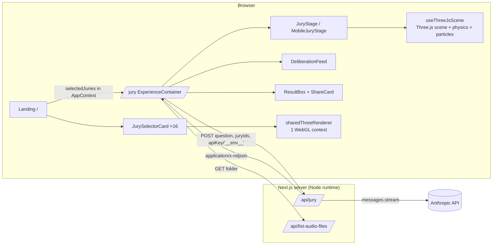
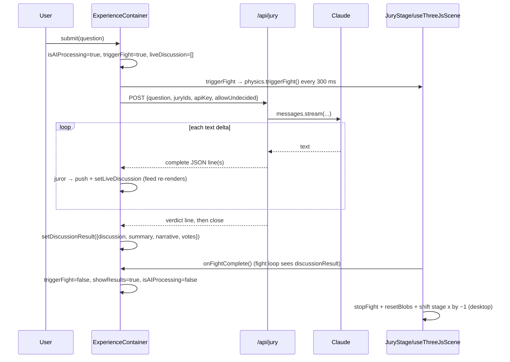

# Cassette Jury — Technical Write-up

> Status: written 2026-10-14 against `main` @ `0975c5d` ("large update!").
> Sources: a full read of every tracked text file, plus `tsc --noEmit` (passes) and `eslint .` (0 errors, 38 warnings).
> The live Claude round-trip was **not** exercised for this write-up, so everything about runtime behaviour comes from reading the code.

---

## Contents

1. [What the product is](#1-what-the-product-is)
2. [Stack and numbers](#2-stack-and-numbers)
3. [Repository map](#3-repository-map)
4. [Runtime architecture](#4-runtime-architecture)
5. [Navigation and global state](#5-navigation-and-global-state)
6. [The jury data model](#6-the-jury-data-model)
7. [The deliberation pipeline (Claude → NDJSON → UI)](#7-the-deliberation-pipeline)
8. [The 3D stage (`useThreeJsScene`)](#8-the-3d-stage)
9. [Physics and the fight loop](#9-physics-and-the-fight-loop)
10. [Landing page and the shared renderer](#10-landing-page-and-the-shared-renderer)
11. [Device policy and responsive behaviour](#11-device-policy-and-responsive-behaviour)
12. [Experience UI layer](#12-experience-ui-layer)
13. [Audio system](#13-audio-system)
14. [Admin area: auth, character generator, style anchor](#14-admin-area)
15. [Assets and the image pipeline](#15-assets-and-the-image-pipeline)
16. [Configuration and environment](#16-configuration-and-environment)
17. [Known issues, ranked](#17-known-issues-ranked)
18. [Documentation drift](#18-documentation-drift)
19. [Dead code and unused dependencies](#19-dead-code-and-unused-dependencies)
20. [Suggested next steps](#20-suggested-next-steps)

---

## 1. What the product is

Cassette Jury is a web toy built by Mia & Ingrid: a "pocket focus group" for creative deadlocks.

1. On the landing page (`/`) the visitor picks **9 of 16** AI jurors.
2. On the stage (`/jury`) those jurors appear as 3D clay-blob characters on a wooden stage.
3. The visitor types an open-ended creative question. The blobs start brawling while Claude deliberates in character.
4. Each juror's take streams in live as a speech-bubble card.
5. When the verdict arrives, the fight stops and a results panel shows:
   - a witty 1–3 word summary
   - a one-line synthesis
   - the vote split
   - every juror's reasoning
6. The verdict can be exported as a 1080-px PNG share card or copied as text.

A separate password-gated `/admin` area holds a 6-step character-generator pipeline (Claude → Gemini → "Tripo" → `juries.ts`) and a "style anchor" editor.

---

## 2. Stack and numbers

| Layer | Choice |
| --- | --- |
| Framework | Next.js **16.1.6** (App Router), React **19.2.3**, TypeScript 5 (strict) |
| Styling | Tailwind CSS 4 via `@tailwindcss/postcss`, plus a lot of inline styles |
| 3D | `three` **0.183**, imperative (no React-Three-Fiber in use), `GLTFLoader`, `MeshToonMaterial` |
| Physics | Hand-written Euler integrator ([utils/physics.ts](../utils/physics.ts)) |
| AI (jury) | `@anthropic-ai/sdk` ^0.104, model `claude-opus-4-8`, adaptive thinking, streaming |
| AI (admin) | Raw `fetch` to Anthropic (`claude-opus-4-1-20250805`) and Gemini (`gemini-3.1-flash-image-preview`) |
| Share card | `html-to-image` (`toPng`) + Web Share API |
| Auth | Next 16 `proxy.ts` (the old `middleware` convention) with a SHA-256 cookie |
| Fonts | Google Fonts: Blaka (display), Bayon (write-up), IBM Plex Mono (body) |

| Metric | Value |
| --- | --- |
| Tracked files | 169 (≈85 text, the rest binary assets) |
| Hand-written TS/TSX | ≈10.3k lines |
| Largest module | [hooks/useThreeJsScene.ts](../hooks/useThreeJsScene.ts) — 1,047 lines |
| Juror GLBs | 16 used, ≈23 MB in total (0.7–2.6 MB each), plus an unused `petra_animated.glb` |
| Git history | 31 commits, 2026-03-15 → 2026-06-12 |

---

## 3. Repository map

```
app/
  layout.tsx                 Root layout: fonts, OG/Twitter metadata, AppProvider + PhysicsProvider
  page.tsx                   Landing (juror selection)
  jury/page.tsx              Stage — renders <ExperienceContainer/>
  writeup/page.tsx           Public project write-up (server component, inline CSS)
  debug/page.tsx             Ad-hoc API test page (public, currently broken — §17)
  globals.css                Tailwind import, fonts, keyframes, reduced-motion override
  admin/                     Password-gated tools (layout, login, character-generator, style-anchor)
  api/
    jury/route.ts            ★ Claude deliberation → NDJSON stream
    list-audio-files/        Lists files in whitelisted public/ audio folders
    auth/login|logout/       Admin cookie set/clear
    admin/style-anchor/      GET/POST public/style-anchor.json
    refine-character/        Claude: draft → refined profile
    generate-images/         Gemini image gen (SVG fallback)
    generate-mesh/           Procedural placeholder GLB (no Tripo call)
    export-character/        Rewrites config/juries.ts on disk
components/
  LandingPage/               Hero, selector grid, per-juror card (live 3D), proceed bar, loading screen
  JuryExperience/            Container/orchestrator, stage(s), feed, input, results, share card, menus
  CharacterGenerator/        Six admin step components + GLBViewer + StyleAnchorManagement
config/
  juries.ts                  ★ The 16 personas (single source of truth)
  prompts.ts                 ★ System/user prompt + NDJSON protocol definition
  constants.ts, sounds.ts, theme.ts, styleAnchor.ts
context/   AppContext (real state), PhysicsContext (stub)
hooks/     useThreeJsScene, useIsMobile, useRandomGibberish
utils/     physics, device, sharedThreeRenderer, shareCard, audio, assets, adminAuth, characterGenerator
types/     app.ts, ai.ts, physics.ts
scripts/   generate-images.mjs (sharp-based asset pipeline)
proxy.ts   Admin route guard
public/    Models, thumbs, backgrounds, smoke sprites, audio, video, legacy write-up HTML
```

---

## 4. Runtime architecture



The parts that matter:

- **The server is thin.** The only production server work is `/api/jury` (a streaming proxy to Claude) and `/api/list-audio-files`. Everything else is client-side.
- **The 3D layer lives outside React.** `useThreeJsScene` owns all WebGL lifecycle through refs and closures. React only receives `isReady`, `loadProgress`, `assetsLoaded` and `hoveredBlobInfo`.
- **The UI is driven by the stream.** Juror lines update `liveDiscussion` one at a time. The fight loop ends only when `discussionResult` is set.

---

## 5. Navigation and global state

### 5.1 `AppContext` ([context/AppContext.tsx](../context/AppContext.tsx))

| Field | Notes |
| --- | --- |
| `allJuries` | Static copy of `config/juries.ts` |
| `selectedJuries` | Set by the landing page on "Summon the Jury" |
| `stage` | `'landing' \| 'selecting' \| 'experience' \| 'results'`. Written in a few places, but **no consumer reads it**, so it is vestigial. |
| `currentQuestion`, `discussionResult`, `isAIProcessing` | Session state for the stage |
| `apiKey` | Defaults to the sentinel **`'__env__'`** (see §7.3). A custom key typed in the side menu is stored in `sessionStorage['anthropic_api_key']`. |
| `settings` | `{ soundEnabled: true, theme: 'light', allowUndecided: false }`. `theme` is never read. |

All state is in memory. **Refreshing `/jury` drops the selection**, and `ExperienceContainer` then sends you back to `/` with `router.replace('/')` ([ExperienceContainer.tsx:60-64](../components/JuryExperience/ExperienceContainer.tsx#L60-L64)).

### 5.2 `PhysicsContext` ([context/PhysicsContext.tsx](../context/PhysicsContext.tsx))

This is a placeholder. `applyForceToBlob` and `settleBlobs` are no-ops, and `triggerFight` just waits 40 s. It is mounted in the root layout but `usePhysics()` is never called. The real physics lives inside `useThreeJsScene`.

### 5.3 Routes

| Route | Type | Notes |
| --- | --- | --- |
| `/` | Client | Landing and selection |
| `/jury` | Client | Stage |
| `/writeup` | Server | Public write-up, reads `juries` for the count and roster |
| `/debug` | Client | **Public**, unauthenticated test harness |
| `/admin/*` | Client | Guarded by `proxy.ts` |
| `/cassette_jury_writeup.html` | Static | Legacy write-up in `public/` (stale, §18) |

---

## 6. The jury data model

`JuryMember` ([config/juries.ts](../config/juries.ts)):

```ts
{ id, name, pronouns, age, location, profession, bio, color, silhouette, voiceProfile }
```

- **`id` is a filename key.** `public/jury/{id}.glb`, `public/jury/{id}.png` and `public/jury/thumbs/{id}.webp` are all resolved from it (see [utils/assets.ts](../utils/assets.ts)). Several ids are leftovers from an earlier cast (`don`, `peggy`, `joan`, `pete`, `roger`, `bertram`, `ken`, `sal`, `harry`) and no longer match the display name. **Never rename an id without renaming its three asset files.**
- `voiceProfile` goes into the prompt and controls how the juror sounds.
- `silhouette` drove image generation in the admin pipeline. It is not used at runtime.
- `color` is the accent for feed bubbles, result borders, share-card rings and the hover-card name.

| id | Display name | Role | Location | Colour |
| --- | --- | --- | --- | --- |
| sable | Sable Kim | Content Strategist & Part-time Chaos Agent | Los Angeles | `#95b638` |
| petra | Petra Voss | Product Manager | Berlin | `#738189` |
| cleo | Cleo Marchetti | Illustrator & Art Director | Milan | `#D3764A` |
| jasper | Jasper Holt | Startup Founder (3rd attempt) | Austin | `#FF9A3C` |
| noor | Noor Al-Rashid | Cultural Strategist & Researcher | Dubai / London | `#76977E` |
| frank | Frank Kowalski | Third-generation Plumber | Pittsburgh | `#B55541` |
| don | Auden Cross | Luxury Brand Creative Director | Paris | `#191970` |
| peggy | Margot Lin | Senior Copywriter | Brooklyn | `#8ca45b` |
| joan | Vivienne Okafor | Talent Agency Director | London | `#930b1f` |
| pete | Theo Brandt | Venture Capital Analyst | Singapore | `#6bbfdb` |
| roger | Gus Fairbanks | Semi-retired Jingle Composer | Palm Springs | `#bdbdbd` |
| bertram | Dr. Ibuki Sato | Design Historian, Emeritus | Kyoto | `#ffe894` |
| ken | Caleb Moss | UX Researcher & Part-time Novelist | Portland | `#6e8fa3` |
| sal | Rafael Duarte | Type Designer | Lisbon | `#ff8f8f` |
| harry | Dex Patel | Trend Forecaster, Streaming Platform | Toronto | `#681d90` |
| takoyaki | Takoyaki | Indie Game Developer | Havana | `#2175b5` |

Lookup helpers: `getJuryById(id)` and `getJuriesByIds(ids)`. The second one silently drops unknown ids and keeps duplicates.

---

## 7. The deliberation pipeline

### 7.1 Prompt construction ([config/prompts.ts](../config/prompts.ts))

`buildJurySystemPrompt(selected, allowUndecided)` produces:

- **SETTING**: the jurors know each other and may push back on each other by name. No fence-sitting.
- **JURY MEMBERS**: a numbered block per juror: name, `id`, profession, age, pronouns, location, bio and voice.
- **RULES**:
  - Reasons are 2–3 sentences.
  - Lopsided splits (7-2, 8-1) are explicitly welcome; the model is told *not* to engineer near-ties.
  - The model must invent two 2–4-word side labels and use them consistently. The literal "Option A/B" is banned.
  - `allowUndecided` adds a third legal stance, `"Undecided"`.
- **OUTPUT FORMAT**: NDJSON only, with no prose and no code fences.

`buildUserPrompt(question)` wraps the question in quotes and repeats the NDJSON reminder.

### 7.2 The NDJSON protocol

Each line is a standalone JSON object:

```jsonc
{"type":"sides","sideA":"Dark Mode","sideB":"Light Mode"}                 // line 1
{"type":"juror","id":"frank","name":"Frank Kowalski","stance":"Dark Mode",
 "reason":"…2–3 sentences…","quote":"…one punchy line…"}                   // ×N, any order
{"type":"verdict","summary":"Lights Out","verdict_narrative":"…≤150 chars…",
 "votes":{"Dark Mode":7,"Light Mode":2}}                                   // last line
{"type":"error","error":"…"}                                               // server-injected on failure
```

Line-delimited JSON is used so each juror can be shown the moment that juror is generated. The client never has to parse a half-finished object.

### 7.3 Server: `POST /api/jury` ([app/api/jury/route.ts](../app/api/jury/route.ts))

1. **Key resolution.** If the client sends `apiKey: '__env__'`, the server swaps in `process.env.ANTHROPIC_API_KEY`. The hosted key therefore never reaches the browser. Any other value is used as a visitor-supplied key and must start with `sk-ant-`.
2. **Validation.**
   - `question` must be a string.
   - `juryIds` must be a non-empty array.
   - At least one id must resolve to a juror.
3. **Model call.**
   ```ts
   client.messages.stream({ model: 'claude-opus-4-8', max_tokens: 16000,
     thinking: { type: 'adaptive' }, system, messages: [{ role: 'user', content }] })
   ```
4. **Line re-framing** ([route.ts:73-86](../app/api/jury/route.ts#L73-L86)).
   - Only `text_delta` events are kept; thinking deltas are ignored.
   - Text goes into a buffer, split on `\n`, and the trailing partial line is held back.
   - Each complete line is checked with `JSON.parse` and forwarded only if it parses. Stray prose is dropped silently.
   - After `finalMessage()` the remaining buffer is flushed.
5. **Errors.**
   - An exception during streaming becomes one `{"type":"error"}` line, and the stream is then closed with HTTP 200.
   - The outer `catch` only covers failures that happen before the stream is created.
6. **Headers.** `application/x-ndjson`, `Cache-Control: no-cache`, and `X-Accel-Buffering: no` (stops nginx-style proxies from buffering).

### 7.4 Client: `handleSubmitQuestion` ([ExperienceContainer.tsx:177-276](../components/JuryExperience/ExperienceContainer.tsx#L177-L276))



- The reader uses the same split-and-keep-tail technique as the server. It also re-parses defensively.
- The `sides` line is **ignored** on the client. Side labels are recovered from the keys of `verdict.votes`.
- Failures raise and go to `failWithError`, which shows the error variant of `ResultBox` (`role="alert"`, z-index 50). Failure cases:
  - no verdict
  - zero juror lines
  - an `error` line
  - a non-2xx response
- Vote counts are not checked against the jurors' actual stances. The prompt asks for consistency, but nothing enforces it.

---

## 8. The 3D stage

[hooks/useThreeJsScene.ts](../hooks/useThreeJsScene.ts) is the engine. Both `JuryStage` (desktop) and `MobileJuryStage` call it with the canvas id `'jury-canvas'`.

### 8.1 Initialisation

- The hook waits 100 ms for layout, measures the canvas, and falls back to `innerWidth × (innerHeight − 80)` if the canvas reports zero size.
- **Camera:** `PerspectiveCamera`, FOV **20°** on desktop and **40°** on mobile, at `(0, 4, 12)`.
- **Renderer:**
  - iOS WebKit: antialiasing off, pixel ratio 1, shadows off.
  - Everyone else: pixel ratio capped at 2.
  - `preserveDrawingBuffer: false` in all cases, because the share card is rendered from the DOM, not the canvas.
- **Lights:** ambient `0.7` and a directional key light at `5.0` from `(-3, 5, 3)`.
- **Background:** a texture, `/velvet-bg.webp` on desktop or `/bg-mobile.webp` on mobile.
- **Stage:** `/stage.glb` (4.7 MB) or `/stage-mobile.glb` (2.2 MB), scaled ×5, rotated −90° about Y, placed at y = −0.7. On iOS WebKit, stage loading is delayed 2 s so the jurors win the memory race.

### 8.2 Real loading progress

The hook hooks into **`THREE.DefaultLoadingManager`**:

- `onProgress` drives `loadProgress`.
- `onLoad` arms a 500 ms "quiet period" before setting `assetsLoaded`, because blob loads start a few frames after initialisation and would otherwise finish "loading" too early.
- `LoadingScreen` shows this progress. It has a 600 ms minimum display time and a 12 s safety net, so a stalled asset can't trap the user.

### 8.3 Placing jurors

`addBlob(id, color, position)` has three paths:

| Path | When | Behaviour |
| --- | --- | --- |
| **GLB + cache** | Default | Load `/jury/{id}.glb`, cache `gltf.scene` per hook instance, place a `.clone()` |
| **Sprite** | `isLowMemoryWebView()` (iOS Safari / in-app browsers) | `THREE.Sprite` with `/jury/{id}.png`, scale 3.5, billboards for free, no GLB memory |
| **Sphere fallback** | GLB or PNG failed to load | Toon icosahedron (r = 0.8), or a sprite tinted with the juror's colour |

`BlobGeometry`'s constructor replaces every mesh material with `MeshToonMaterial({ color: white, map: originalMap })` for cel shading and recomputes normals.

**Layout.**

- **Desktop** ([JuryStage.tsx:46-73](../components/JuryExperience/JuryStage.tsx#L46-L73)): two rows (5 + 4 for nine jurors), x spread across 5.3 units, back row at z ≈ −1…−0.5, front row at z ≈ 0…0.5, with ±0.05 jitter.
- **Mobile** ([MobileJuryStage.tsx:46-74](../components/JuryExperience/MobileJuryStage.tsx#L46-L74)): fixed 3-3-3 rows stepping forward in z (0, 0.9, 1.8).

### 8.4 Grounding — keeping feet on the stage

`groundBlob` ([L148-181](../hooks/useThreeJsScene.ts#L148-L181)):

1. Temporarily set scale to 1 and measure `footOffset = position.y − bbox.min.y`.
2. Raycast straight down from y = 1000 at the blob's (x, z) against the stage. If the ray misses, use the top of the stage's bounding box.
3. Set `y = floorY + footOffset`. Store `{floorY, footOffset}` and patch the stored reset and base positions so later resets keep the grounded height.

Blobs that load before the stage are grounded again in the stage's `onLoad`.

The idle "breathing" animation scales each blob by `1 ± 0.05·sin(2t + x)`. Scaling from the origin would lift or sink the feet, so each frame sets `y = floorY + scale·footOffset` while the blob is not fighting ([L821-835](../hooks/useThreeJsScene.ts#L821-L835)).

### 8.5 Camera and input

| Input | Effect |
| --- | --- |
| Left-drag (mouse) / one-finger drag | Orbit: `targetTheta −= dx · 0.005` |
| Wheel / pinch | Distance clamped to 8–18 (`±0.5` per wheel tick; pinch `Δ · 0.05`) |
| Hover (desktop) | Per-frame raycast → `hoveredBlobInfo` (React state, deduplicated within 1 px) |
| Long-press 500 ms (touch, < 10 px movement) | Same hover card; released on `touchend` |

Theta and distance are low-pass filtered toward their targets (factor 0.1).

The intro is a 2.5 s cosine-eased pull-back from distance 4 to the target distance. It advances by a hard-coded 16 ms per frame, so it runs faster on 120 Hz screens.

During a fight the camera shakes by ±0.03 using sinusoids, and the shake is disabled under `prefers-reduced-motion`.

### 8.6 Smoke particles

- A pool of **200** pre-allocated `PlaneGeometry` quads with `MeshBasicMaterial` (transparent, `depthTest: false`, `renderOrder: 10`). Textures are picked at random from `/smoke/smoke{1,2,3}.png`.
- **Ambient smoke:** one particle per blob every 6 frames.
- **Impact bursts:** 2–3 particles at the midpoint of any pair closer than `r₁ + r₂ + 0.5`, checked every 3 frames.
- **Per-particle life:** lives 0.6–1.2 s, grows from 0.2× to 1.2× `baseScale`, fades opacity linearly from 0.15–0.20, drifts up, and turns to face the camera with `lookAt(camera)`.
- The tint is interpolated between `#C9C3B8` and `#C7B89B`.

### 8.7 Results layout shift

When `showResults && discussionResult` is set ([L110-139](../hooks/useThreeJsScene.ts#L110-L139)):

- The fight stops and blobs return to their stored positions.
- Rotation is reset to `(0, −π/2, 0)`.
- On desktop, the stage and all blobs move to `x −= 1` so they aren't hidden behind the 320 px results sidebar.

### 8.8 Cleanup

On cleanup the hook:

- removes its listeners
- cancels the animation frame
- disposes the renderer and the particle pool
- detaches the loading-manager callbacks

It does **not** dispose juror or stage geometry, materials or textures (§17).

---

## 9. Physics and the fight loop

### 9.1 `BlobGeometry`

Each blob has state `{velocity, force, mass=1, damping=0.98, colliderRadius (1.0 model / 0.8 sphere), fightMode, rotationSpeed ∈ [1.5, 4.5) rad/s, targetBlob}`. One `update(dt)` step:

```
v += (F / m)·dt;  v *= 0.98;  p += v·dt;  if fighting: rotY += rotationSpeed·dt;  F = 0
```

### 9.2 `PhysicsSimulator`

- **Box bounds:** x ±2.9, y ±2.1, z ±1.7. Walls are inset by the collider radius, and the reflected velocity is multiplied by 0.7.
- **Forces are applied only in fight mode:**
  - **Pursuit:** a force toward `targetBlob` of magnitude `min(8·distance, 25)`.
  - **Overlap:** for each other blob closer than `r₁ + r₂`, a force of `0.5 · 10 · overlap` along `other − self`. This pulls the blob *toward* the other one (see §17 #9). The effect is clumping, not separation.
- **Gravity is deliberately off** so blobs stay airborne. The line is commented out.
- **`triggerFight()`:** gives every blob a new random target that isn't itself.
- **`resetBlobs()`:** zeroes velocities and restores the stored positions.
- The simulator does **not** read the `PHYSICS_*` values in `config/constants.ts`; its numbers are hard-coded.

### 9.3 How the fight is choreographed

`JuryStage` / `MobileJuryStage` ([JuryStage.tsx:79-117](../components/JuryExperience/JuryStage.tsx#L79-L117)) run this loop while `triggerFight` is true:

```
startFight(): physics.triggerFight()  // re-roll targets
              if discussionResult → onFightComplete(); stop
              else setTimeout(startFight, 300)
```

So the fight gets new random targets every 300 ms, and that constant retargeting is the frantic look. The loop runs **until a result arrives**. There is no upper time limit, and `FIGHT_DURATION_MS` (40 s) is not read here.

---

## 10. Landing page and the shared renderer

### 10.1 Selection

- `JurySelector` keeps a `Set<string>` of ids with a cap of `SELECTED_JURIES_COUNT = 9`. Once 9 are selected, the other cards are greyed out and disabled.
- `ProceedBar` is enabled only at exactly 9. Clicking it plays a click, copies the selection into `AppContext`, and calls `router.push('/jury')`.
- No API key input is needed: the hosted-key sentinel covers it.

### 10.2 `JurySelectorCard` — the hybrid tile

Each 100–140 px circular tile has two layers:

1. A **WebP thumbnail** (`/jury/thumbs/{id}.webp`, 512², lazy-loaded) that paints immediately.
2. A **live rotating 3D render** that fades in over it (0.4 s) once the GLB has loaded. Skipped on iOS WebKit.

Loading 16 GLBs at once would mean ~23 MB arriving together, so a module-level queue limits it to **4 concurrent loads** (`enqueueModelLoad` / `finishModelLoad`). A failed load is retried once after 500 ms. If it fails again, the thumbnail stays.

### 10.3 `sharedThreeRenderer` — one WebGL context for 16 cards

[utils/sharedThreeRenderer.ts](../utils/sharedThreeRenderer.ts):

- iOS limits a page to roughly 8 WebGL contexts, so 16 separate renderers would crash it. Instead there is **one** off-screen `WebGLRenderer` (256², `low-power`, `preserveDrawingBuffer: true`).
- Each card registers `{scene, camera, targetCanvas, onBeforeRender}` (here, `rotation.y += 0.01`).
- One `requestAnimationFrame` loop renders each registered scene into the shared canvas, then copies the result into that card's 2D canvas with `drawImage`.
- When the last card unregisters, the loop stops and the renderer is disposed.

Each card uses an orthographic camera (±0.8), a `#E5E5E1` background, ambient light 1.5 and a directional light 2.

### 10.4 Hover and long-press cards

- On desktop, a juror card (name, age, pronouns, role, bio) is shown on hover or focus, positioned `fixed` above the tile and clamped near the edges (180 px threshold).
- On touch devices, a 500 ms long-press shows the same card. `touchmove` / `touchend` listeners on `document` cancel or hide it.

---

## 11. Device policy and responsive behaviour

| Helper | Rule | Used by |
| --- | --- | --- |
| `isLowMemoryWebView()` ([utils/device.ts](../utils/device.ts)) | `(iPhone/iPad/iPod UA \|\| MacIntel with >1 touch points) && !CriOS` | Stage sprite fallback, renderer downgrades, skipping live landing renders |
| `useIsMobile()` ([hooks/useIsMobile.ts](../hooks/useIsMobile.ts)) | `innerWidth < 768 \|\| ('ontouchstart' in window && maxTouchPoints > 0)` | Picking the stage component, feed/result/input layout |

There are inline copies of the `useIsMobile` rule in `useThreeJsScene` (initialisation and the results effect) and a width-only check in `JuryInfoTooltip`.

The rule for which devices get real models is: **real GLBs everywhere except iOS WebKit**. iPadOS (which reports itself as a Mac) and in-app browsers count as iOS WebKit; Chrome on iOS does not. `isLowMemoryWebView()` is the one place this is decided.

What changes on mobile:

| Element | Mobile change |
| --- | --- |
| Camera FOV | 40° |
| Background / stage | `bg-mobile.webp`, `stage-mobile.glb` |
| Layout | 3-3-3 rows |
| Hover | Long-press only |
| Deliberation feed | Last 2 bubbles, pinned 148 px above the bottom wordmark |
| `ResultBox` | Bottom sheet at 45 vh instead of a 320 px right sidebar |
| Stage shift on results | None |

---

## 12. Experience UI layer

### 12.1 Layering in `ExperienceContainer`

The container is a full-viewport flex column (`.full-dvh` for iOS toolbars) with a 20 px cream border.

| z | Element |
| --- | --- |
| 0 | `<canvas id="jury-canvas">` |
| 10 | `TopBar` (menu button only) |
| 25 | `DeliberationFeed` (pointer-events none) |
| 30 | `InputBox` (fixed, top centre) |
| 36 | `StatusBar` (giant Blaka wordmark at the bottom) |
| 40 / 50 | `ResultBox` (50 for the error variant) |
| 50 | `SideMenu`, `LoadingScreen` |
| 100 | `BlobHoverCard` |

### 12.2 Components

- **`InputBox`**
  - Textarea with a 1,000-character cap and counter. Ctrl+Enter or the button submits.
  - After submitting, it becomes a static `<h3>` showing the question.
- **`DeliberationFeed`**
  - `role="log" aria-live="polite"`.
  - Shows the last 3 (desktop) or 2 (mobile) streamed jurors as `blobcard.webp` bubbles with the thumbnail, name in the juror's accent colour, a stance pill and the quote.
  - Animated with `feedBubbleIn`.
- **`StatusBar`** (file `ControlBar.tsx`)
  - Text cycles: "Cassette Jury" → "Jury Deciding" → "Jury Made Decision".
  - The outline is a separate span behind the text using `-webkit-text-stroke`, because Safari ignores `paint-order` on HTML.
  - Colours swap while processing.
- **`ResultBox`**
  - Summary, narrative, vote percentages, and the full deliberation list (border in each juror's colour).
  - Actions: **Ask Again**, **Save Verdict Card**, **Copy Verdict**, **Back**.
  - The background is `sidebar.webp`, and it slides in from the right on desktop or from the bottom on mobile.
- **`ShareCard` + `shareNodeAsPng`**
  - A 1080-px-wide card is always mounted off-screen at `left: −10000px`. It contains the wordmark, question, summary (96 px Blaka), vote bar, the first 3 quotes with portraits, and a strip of every juror's thumbnail.
  - `shareNodeAsPng` downloads the Google Fonts CSS, inlines every `fonts.gstatic.com` file as a data URL (html-to-image can't fetch cross-origin fonts), and renders at 2× with a style override that brings the off-screen clone back into the capture area.
  - It then uses `navigator.share({files})` where available, and falls back to an `<a download>`.
- **`BlobHoverCard`**
  - Name, age and role always. Shows the bio before the verdict, and the juror's vote and reasoning after (matched by `id`, falling back to the name).
  - Hidden while processing, and clamped to the viewport.
- **`SideMenu`**
  - API-key section: shows "Hosted key", or a masked key showing the first and last 10 characters.
  - Toggles for sound and "Allow undecided", an About section, and a link to the write-up.
  - The footer button resets to the hosted key and does a full reload to `/`.
- **`LoadingScreen`**
  - Red full-screen splash with a progress bar shaped like tape.
  - Two modes: driven by real progress (used here) or timer-only (2.2 s default).

### 12.3 Global CSS ([app/globals.css](../app/globals.css))

- Headings use Blaka; everything else, including `div`, uses IBM Plex Mono.
- Defines the keyframes for sidebar, bottom sheet and feed bubbles, and the `.result-action-btn` style.
- A **global `prefers-reduced-motion` override** shrinks every CSS animation and transition to 0.01 ms.
- A `prefers-color-scheme: dark` block redefines `--background` / `--foreground`. Nearly every surface sets its own colours inline, so this has almost no effect.

---

## 13. Audio system

Files: [config/sounds.ts](../config/sounds.ts), [utils/audio.ts](../utils/audio.ts), [hooks/useRandomGibberish.ts](../hooks/useRandomGibberish.ts).

| Category | Folder | Volume | When |
| --- | --- | --- | --- |
| Music | `/music` (1 MP3) | 0.5 | Looped while idle on the stage |
| Fighting | `/fighting` (1 WAV) | 0.6 | Looped during the fight |
| Result | `/result` (2 WAVs) | 0.7 | **All** files at once when results appear |
| Gibberish | `/gibberish` (4 WAVs) | 0.4 | One random clip every 5–7 s, on the landing page and during results |
| SFX | `/sfx` click/paper | 0.8 | Card click, hover, blob hover |

- Folder contents come from `GET /api/list-audio-files?folder=…`. The folder must be one of 5 whitelisted values (which prevents path traversal) and only audio extensions are returned.
- `ExperienceContainer` runs a small state machine over `(soundEnabled, triggerFight, showResults, discussionResult)`: idle → music, fighting → fight loop, results → stings plus gibberish.
- `stopSound` pauses, rewinds, and calls `replaceWith(cloneNode)`. On a detached `Audio` element, `replaceWith` does nothing, so the call is effectively just pause and rewind.
- Gibberish starts after a 1 s delay so autoplay is less likely to be blocked. Browsers still need a user gesture first.

---

## 14. Admin area

### 14.1 Auth

- **[proxy.ts](../proxy.ts)** (the Next 16 replacement for `middleware.ts`) guards:
  - `/admin/*` except `/admin/login`
  - `/api/admin/*`
  - `/api/generate-images`, `/api/generate-mesh`, `/api/refine-character`, `/api/export-character`
- **The cookie** `admin-auth` must equal `hex(SHA-256("cassette-jury-admin-v1:" + ADMIN_PASSWORD))`. It is computed with WebCrypto ([utils/adminAuth.ts](../utils/adminAuth.ts)) so it runs on the edge.
  - The cookie is HTTP-only, SameSite=Lax, valid for 7 days, and `Secure` in production.
  - It can't be forged without the password. The value is fixed, though, so it can't be revoked without changing the password.
- **On failure:** pages redirect to `/admin/login`, and APIs return 401 JSON.
- Login compares the password with `!==`. There is no rate limiting or lockout.

### 14.2 The character generator ([app/admin/character-generator/page.tsx](../app/admin/character-generator/page.tsx))

Six steps are held in local state: `draft → refine → images → select → mesh → review`. The stepper buttons unlock as earlier results arrive.

| Step | UI says | What actually happens |
| --- | --- | --- |
| 1 Draft | Name, bio and colour are required | Form only |
| 2 Refine | "Refine with Claude" | Browser sends `NEXT_PUBLIC_CLAUDE_API_KEY` to `/api/refine-character`. The route fetches the style anchor, calls `claude-opus-4-1-20250805` with raw `fetch`, then `JSON.parse`s `content[0].text` (fails if the reply is wrapped in a code fence). The result is editable. |
| 3 Images | "Generate **4** images (1024²)" | `/api/generate-images` calls Gemini `gemini-3.1-flash-image-preview` **twice** ("happy" and "thoughtful" prompts). On any failure, **both** images are replaced with procedural SVG blobs. |
| 4 Select | "Sent to Tripo AI, 5000 polys" | Stores the chosen index |
| 5 Mesh | "Tripo AI — Fast 2–3 min / Quality / Ultra 15–30 min" | `/api/generate-mesh` makes **no external call**. It builds a procedural GLB synchronously in Node (and the file is invalid, see §17 #5). The Tripo key is only checked for being non-empty. |
| 6 Review | "Add to juries.ts" | `/api/export-character` reads `config/juries.ts` from disk, inserts a TS object literal after the last `  },`, and writes it back. Also offers "Copy code" and "Download JSON". |

**Admin helpers.**

- `GLBViewer` (a Babylon.js iframe viewer for the generated GLB) exists but is not mounted anywhere.
- [utils/characterGenerator.ts](../utils/characterGenerator.ts) holds older client-side versions of the three API calls (including a fake `api.endpoints.antml.ai/text2img` endpoint and a Tripo call). Only `formatCharacterAsTypeScript` is still used.

### 14.3 Style anchor

- `StyleAnchor` fields: `{version, rendering_style, lighting, color_palette, character_framing, prohibited_elements[], reference_prompts[], last_updated}`.
- Defaults are in [config/styleAnchor.ts](../config/styleAnchor.ts).
- `GET` / `POST /api/admin/style-anchor` reads and writes `public/style-anchor.json`. That file doesn't exist yet, so the defaults are served.
- `refine-character` appends the anchor to its system prompt as rules the model must follow. Because of §17 #7, that injection never succeeds in practice.

---

## 15. Assets and the image pipeline

### 15.1 Runtime assets in `public/`

| Asset | Size | Used by |
| --- | --- | --- |
| `jury/{id}.glb` ×16 | ≈23 MB total | Stage, landing live renders |
| `jury/{id}.png` ×16 | — | iOS sprite fallback; source for thumbs |
| `jury/thumbs/{id}.webp` ×16 | 512² q82 | Landing tiles, feed, share card |
| `stage.glb` / `stage-mobile.glb` | 4.7 MB / 2.2 MB | Stage floor |
| `velvet-bg.webp` / `bg-mobile.webp` | — | Scene background |
| `smoke/smoke{1,2,3}.png` | — | Particles |
| `blobcard.webp`, `sidebar.webp`, `menu.svg` | — | UI chrome |
| `og.jpg` | 1200×630 | OG/Twitter card |
| `cassete jury.mp4` | **51 MB** | `/writeup` autoplay video |
| `jury_fan_art.png` | 352 KB | `/writeup` |

**Not referenced anywhere:**

- `jury/petra_animated.glb`
- the `MacBook Pro 16_ - {1,2,4,5}.png` mockups (only `- 1.png` is read by the build script)
- `velvet-bg.png` / `bg-mobile.png` (build-script sources only)
- the Next starter SVGs (`file`, `globe`, `next`, `vercel`, `window`)
- `cassette_jury_writeup.html`

### 15.2 `scripts/generate-images.mjs`

Run with `node scripts/generate-images.mjs`. It uses `sharp` to:

1. Resize `public/jury/*.png` to 512² cover crops and save them as WebP q82 in `thumbs/`.
2. Convert `velvet-bg.png` and `bg-mobile.png` to WebP q80.
3. Crop 4% off `MacBook Pro 16_ - 1.png` and fit it to 1200×630 (`position: 'attention'`) as `og.jpg` q85.

`sharp` is **not** in `package.json`. The script only works because Next installs it as an optional dependency.

---

## 16. Configuration and environment

| Variable | Scope | Purpose |
| --- | --- | --- |
| `ANTHROPIC_API_KEY` | Server | Hosted jury key (replaces the `'__env__'` sentinel) |
| `ADMIN_PASSWORD` | Server + edge | Admin login and cookie derivation |
| `NEXT_PUBLIC_SITE_URL` | Build | `metadataBase` / OG URL (default `https://cassettejury.vercel.app`) |
| `NEXT_PUBLIC_CLAUDE_API_KEY` | **Client bundle** | Admin refine step |
| `NEXT_PUBLIC_GOOGLE_NANO_BANANA_KEY` | **Client bundle** | Admin image step (Gemini) |
| `NEXT_PUBLIC_TRIPO_AI_KEY` | **Client bundle** | Admin mesh step (checked for presence only) |

Other configuration:

- `next.config.ts` is empty.
- The `tsconfig` path alias is `@/* → ./*`.
- ESLint uses `eslint-config-next` core-web-vitals and typescript presets.
- `.env*` is git-ignored.

**Build health at time of writing:** `tsc --noEmit` passes. `eslint .` reports 0 errors and 38 warnings: unused variables and imports (e.g. `APP_CONSTANTS` in both stage components, `_` loop bindings, `initialCameraTheta`), `` usage, and similar.

---

## 17. Known issues, ranked

Severity: 🔴 security or money · 🟠 broken behaviour · 🟡 latent bug / inconsistency · ⚪ code health.

| # | Sev | Issue | Where |
| --- | --- | --- | --- |
| 1 | 🔴 | **Admin API keys are shipped to every browser.** `NEXT_PUBLIC_*` values are inlined into client JS at build time. The admin *pages* are gated, but `/_next/static/chunks/*` is not, so anyone who fetches the chunk can extract the Claude and Gemini keys. Fix: read them from server-only env vars inside the API routes and stop sending them from the client. | [RefineStep.tsx:31](../components/CharacterGenerator/RefineStep.tsx#L31), [ImagesStep.tsx:30](../components/CharacterGenerator/ImagesStep.tsx#L30), [MeshStep.tsx:53](../components/CharacterGenerator/MeshStep.tsx#L53) |
| 2 | 🔴 | **The hosted key can be spent by anyone without limit.** `/api/jury` accepts `'__env__'` from any caller, with no rate limit, no server-side question length cap (the 1,000-character limit is client-only), duplicate `juryIds` allowed, and `max_tokens: 16000` on Opus with thinking. A script can drain the key. Add per-IP rate limiting, a server-side length/count cap, and id de-duplication. | [app/api/jury/route.ts:17-63](../app/api/jury/route.ts#L17-L63) |
| 3 | 🔴 | **`/debug` is public and sends the hosted sentinel.** The default `apiKey` is `'__env__'`, so the page can spend the hosted key. It also calls `res.json()` on an NDJSON response, so it always shows a parse error. Delete it or put it behind the proxy. | [app/debug/page.tsx:25-58](../app/debug/page.tsx#L25-L58) |
| 4 | 🟠 | **Exporting a character breaks the build.** The inserted object includes `style_version`, which `JuryMember` doesn't declare → TypeScript excess-property error. Other problems: `name`, `pronouns`, `location` and `profession` aren't quote-escaped (an apostrophe breaks the file), and the route writes to the source tree, which can't work on a read-only serverless filesystem. | [export-character/route.ts:32-58](../app/api/export-character/route.ts#L32-L58) |
| 5 | 🟠 | **The generated GLB is invalid.** (a) `Buffer.from(Float32Array)` copies values truncated to bytes instead of the raw bytes (verified: 2 floats → 2 bytes, not 8); it should be `Buffer.from(arr.buffer)`. (b) The indices are `Uint16Array` but the accessor declares `5125` (UNSIGNED_INT). (c) The BIN chunk isn't padded to 4 bytes. (d) The "mesh" is a triangle fan from the last vertex, not a sphere. The step is a stand-in for Tripo regardless. | [generate-mesh/route.ts:95-143,180,234](../app/api/generate-mesh/route.ts#L126-L143) |
| 6 | 🟠 | **The character exporter can't produce assets.** Even with a valid mesh, export writes only the TS object. The GLB, PNG and thumb never go into `public/jury/{id}.*`, so a new juror loads as the fallback sphere and a broken thumbnail. | [export-character/route.ts:60-64](../app/api/export-character/route.ts#L60-L64) |
| 7 | 🟠 | **The style anchor is never applied.** `refine-character` fetches its own `/api/admin/style-anchor` over HTTP *without the admin cookie*, so `proxy.ts` returns 401 and the anchor is silently skipped. In production it also builds the URL from the `Host` header. Import `getStyleAnchor()` directly instead. | [refine-character/route.ts:21-30](../app/api/refine-character/route.ts#L21-L30) |
| 8 | 🟠 | **Ctrl+Enter stops working after the first question.** `InputBox` checks its *local* `submittedQuestion`, which "Ask Again" (resetting the *parent's* copy) never clears. The previous question also stays in the textarea. `onKeyPress` is deprecated too. | [InputBox.tsx:45](../components/JuryExperience/InputBox.tsx#L45) |
| 9 | 🟡 | **"Collision" pulls blobs together.** The force runs along `other − self` and is applied to `self`, so overlapping blobs attract. The write-up calls this "elastic push-apart". If the clumping is the intended brawl look, document it; if not, flip the sign. | [physics.ts:226-238](../utils/physics.ts#L226-L238) |
| 10 | 🟡 | **Hover highlight does nothing on GLB jurors.** `setHighlight` only touches `MeshStandardMaterial`, but every mesh was converted to `MeshToonMaterial`. Only sprites react. | [physics.ts:140-150](../utils/physics.ts#L140-L150) |
| 11 | 🟡 | **The camera shift on results is dead code.** `animate` is created once at initialisation and captures `showResults` / `discussionResult` from the first render, so `cameraShiftX` is always 0. The visible shift comes entirely from moving the stage and blobs by −1. | [useThreeJsScene.ts:621](../hooks/useThreeJsScene.ts#L621) |
| 12 | 🟡 | **Simulation speed depends on frame rate.** Physics, smoke and the intro animation all step by a fixed 16 ms per frame, so on 120/144 Hz displays the fight runs about 2× faster. Use a `THREE.Clock` delta (clamped). | [useThreeJsScene.ts:639,720,742](../hooks/useThreeJsScene.ts#L742) |
| 13 | 🟡 | **No timeout or abort on the stream.** If Claude stalls, the fight loops forever. Leaving `/jury` mid-stream keeps the reader running and calling `setState`. Add an `AbortController`, unmount cleanup, and a cap (e.g. 90 s). | [ExperienceContainer.tsx:194-257](../components/JuryExperience/ExperienceContainer.tsx#L194-L257) |
| 14 | 🟡 | **GPU memory leaks between visits.** Scene cleanup disposes the renderer and particles but not the blobs' geometry, materials and textures, the stage, the background texture or the smoke textures. `removeBlob` also skips `blobBasePositionsRef`, `blobGroundInfoRef` and `blobToJuryRef`. | [useThreeJsScene.ts:843-871,1014-1023](../hooks/useThreeJsScene.ts#L843-L871) |
| 15 | 🟡 | **Touchscreen laptops get the mobile UI.** `useIsMobile` treats *any* touch-capable device as mobile (FOV 40, bottom sheet, long-press only). Crossing the breakpoint swaps `JuryStage` ↔ `MobileJuryStage`, which rebuilds the scene and reloads every GLB. | [useIsMobile.ts:5-6](../hooks/useIsMobile.ts#L5-L6) |
| 16 | 🟡 | **Global loading manager.** `DefaultLoadingManager` is shared with the landing-page card loaders, so progress can mix with in-flight landing loads. The `LoadingScreen` safety-net timer also restarts on every progress update, so the "12 s" cap is really 12 s *after the last progress event*. | [useThreeJsScene.ts:197](../hooks/useThreeJsScene.ts#L197), [LoadingScreen.tsx:79](../components/LandingPage/LoadingScreen.tsx#L79) |
| 17 | 🟡 | **Gemini response handling is fragile.** The key goes in the URL query string, so it shows up in logs. The mime type is read from `mime_type`, but REST returns `mimeType`. Only `parts[0]` is checked, and image models often put text first, which forces the SVG fallback. The UI promises 4 images; 2 are generated. | [generate-images/route.ts:54,82-86](../app/api/generate-images/route.ts#L82-L86) |
| 18 | 🟡 | **The style-anchor list fields can't gain new lines.** The textareas drop empty lines on every keystroke, so pressing Enter after the last item does nothing. | [StyleAnchorManagement.tsx:155,167](../components/CharacterGenerator/StyleAnchorManagement.tsx#L155) |
| 19 | 🟡 | **Audio listing may come back empty on Vercel.** `readdir(process.cwd()/public/…)` relies on `public/` being inside the function bundle. If it isn't, the route quietly returns `[]` and fight, result and gibberish audio go silent. A static manifest in `config/sounds.ts` would be more robust. | [list-audio-files/route.ts:22](../app/api/list-audio-files/route.ts#L22) |
| 20 | ⚪ | **The landing renders are blurry on Retina.** The card canvas is sized to CSS pixels (no DPR) while the shared renderer draws at 256². All 16 scenes also re-render every frame, even off-screen. | [JurySelectorCard.tsx:81](../components/LandingPage/JurySelectorCard.tsx#L81) |
| 21 | ⚪ | **Admin cookie hardening.** The cookie value is fixed (no expiry or rotation server-side), the comparison isn't constant-time, and login has no rate limit. Acceptable for a toy, but worth noting. | [utils/adminAuth.ts](../utils/adminAuth.ts) |
| 22 | ⚪ | **Unreachable iOS GLB queue.** In `addBlob`, the iOS sprite branch returns early, so `loadQueueRef`, `advanceQueue` and the `isSafariIOS` checks inside `doLoad` never run. `animationCacheRef` is filled but never read. | [useThreeJsScene.ts:939-946,1002-1008](../hooks/useThreeJsScene.ts#L1002-L1008) |
| 23 | ⚪ | **Misleading comments.** The shake comment claims "7.7–14.3 Hz", but the frequency is `sin(0.01t)`. The pull-back comment says "3 → 5", but the code goes 4 → target. | [useThreeJsScene.ts:628,667-668](../hooks/useThreeJsScene.ts#L667-L668) |

---

## 18. Documentation drift

Several documents describe earlier versions of the project. The **public** ones matter most before any award submission.

| Document | Out of date |
| --- | --- |
| [app/writeup/page.tsx](../app/writeup/page.tsx) (public) | Shows a single-object "JSON output contract" `{discussion[], summary, …}`; the real protocol is streamed NDJSON. Says "Morph targets … preserved for blendshape-driven facial animation", but no `AnimationMixer` or morph driving exists. Presents Tripo image-to-3D as a working pipeline step. Calls collision "elastic push-apart" (see §17 #9). The flow subtitle reads "Choose of all" (a number is missing). |
| `public/cassette_jury_writeup.html` (public) | The original **11-juror** cast (Margot Chen, Dev Kapoor, Murray Fink…), an older schema (`dominant_direction`, `vote_breakdown`), and different fonts and colours. Still served at `/cassette_jury_writeup.html`. |
| [SideMenu.tsx:168](../components/JuryExperience/SideMenu.tsx#L168) (public) | "a panel of **11** AI-simulated characters" — the roster has 16. |
| [README.md](../README.md) | "Each tile is a pre-rendered WebP portrait"; tiles are now hybrid WebP plus live 3D. Otherwise accurate. |
| [IMPLEMENTATION_STATUS.ts](../IMPLEMENTATION_STATUS.ts) | Describes the March prototype: 11 jurors, sphere blobs, 500-character limit, a 3.5 s fight, `ApiKeyInput.tsx`, a "Bottom control bar with buttons". Nothing imports it. |
| [app/admin/README.md](../app/admin/README.md) | Says 4 images (2 are generated), "Tripo AI 2–5 min" (no external call is made), keys "must be prefixed with `NEXT_PUBLIC_`" (that is the cause of §17 #1), and omits `style_version` from the exported template. |
| `config/constants.ts` | `MOBILE_SELECTED_JURIES_COUNT: 7` (the mobile layout is 3-3-3 = 9). `PHYSICS_*` and `CANVAS_*` values aren't read by the engine. |
| `config/theme.ts` | `blobColors` refers to the retired cast (margot, dev, riz…). The file isn't imported anywhere. |
| `.claude/skills/web-artifacts-builder/SKILL.md` | An empty (0-byte) tracked file. |

---

## 19. Dead code and unused dependencies

- **Never imported or rendered:**
  - `LoadingOverlay.tsx`
  - `JuryInfoTooltip.tsx`
  - `GLBViewer.tsx`
  - `config/theme.ts`
  - `IMPLEMENTATION_STATUS.ts`
  - `usePhysics()` (only the provider is mounted)
- **`TopBar.tsx`:** about 60 lines of screenshot code (`handleScreenshot`, `captureCanvasOnly`, its own copy of `buildFontEmbedCSS`) that no button calls. It also duplicates `utils/shareCard.ts`.
- **`utils/characterGenerator.ts`:** `refineCharacterWithClaude`, `generateImagesWithGeminiNano`, `generateMeshWithTripoAI` and `nameToId` are unused. Only `formatCharacterAsTypeScript` is live.
- **`utils/audio.ts`:** `loadAudioFiles` (always returns `[]`) and `fadeAudio` are unused.
- **`config/sounds.ts`:** `initializeAudioFiles` and the mutable `AUDIO_FILES.FIGHTING/GIBBERISH/RESULT` arrays are unused. Components fetch the lists themselves.
- **Other unused symbols:**
  - `types/ai.ts` → `AIResponse`, `AIJuryResponse`
  - `types/app.ts` → `CharacterGeneratorState`, `GeneratedImages`, `GeneratedMesh`
  - `utils/assets.ts` → `jurySprite` (the stage hard-codes the path)
  - `config/constants.ts` → `endpoints`
- **Unused dependencies:** `@react-three/fiber`, `@react-three/drei`, `@react-three/rapier`. `@types/three` belongs in `devDependencies`. `sharp` is used but not declared.
- **Duplication:** `JuryStage.tsx` and `MobileJuryStage.tsx` are ~95% identical; only the layout differs. The `useIsMobile` rule is copied inline in 3 places.

---

## 20. Suggested next steps

In priority order:

1. **Lock down keys and spending (§17 #1–3).**
   - Move admin keys to server-only env vars.
   - Add rate limiting and a server-side length cap to `/api/jury`.
   - Remove or gate `/debug`.
2. **Fix public documentation drift (§18).** Update the `/writeup` schema box and claims, change "11" to `juries.length` in the side menu, and delete `public/cassette_jury_writeup.html`.
3. **Make the stream robust (§17 #13).** Add an `AbortController` with unmount cleanup and a deliberation timeout that resolves to the error card.
4. **Quick correctness fixes.**
   - Ctrl+Enter state (#8)
   - toon-material highlight, e.g. `emissive` on `MeshToonMaterial` (#10)
   - frame-rate-independent `dt` (#12)
   - decide the collision sign (#9)
5. **Character generator.** Either finish it or label it a prototype in the admin UI:
   - a real Tripo task with polling
   - write GLB, PNG and thumb into `public/jury/`
   - drop `style_version` or add it to `JuryMember`
   - read the style anchor directly
6. **Cleanup.**
   - Merge the two stage components into one with a layout prop.
   - Remove dead files and the unused `@react-three/*` dependencies.
   - Declare `sharp`.
   - Dispose GPU resources on unmount.
   - Decide what to do with the 51 MB video (re-encode or host on a CDN) and the unused mockups.
